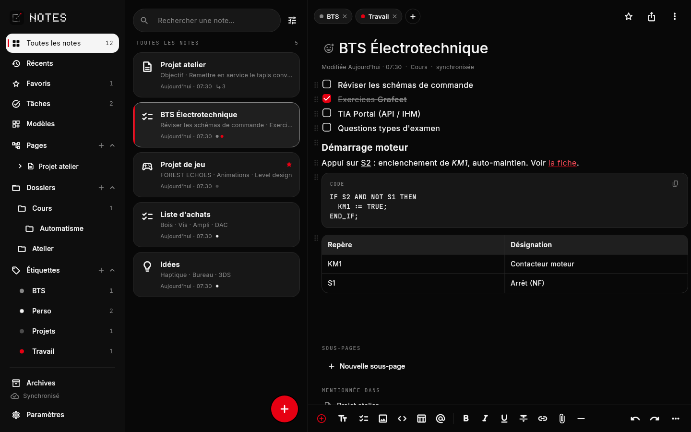
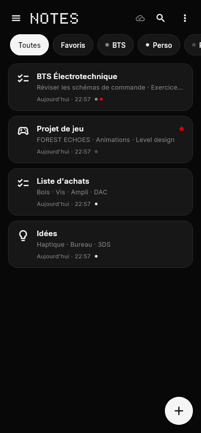
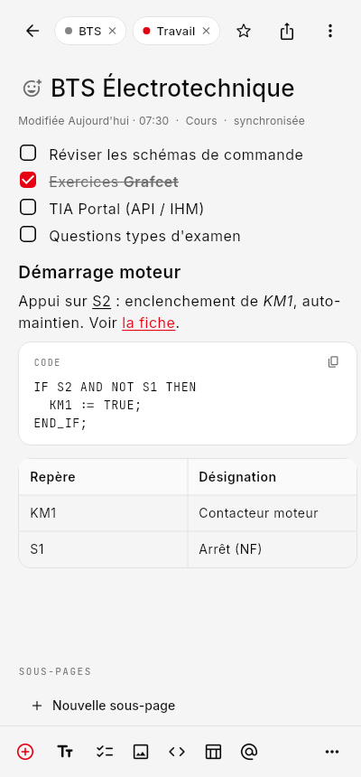
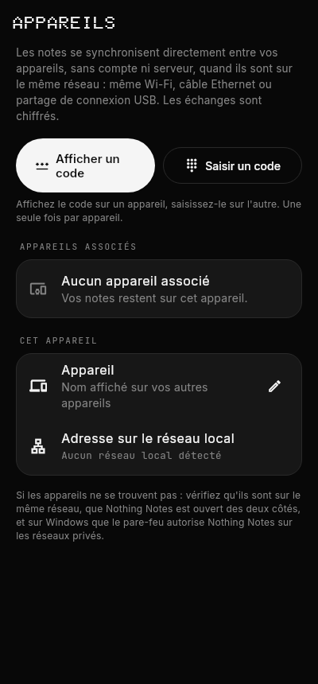

<p align="center">
  
</p>

<h1 align="center">NOTHING NOTES</h1>

<p align="center">
  Prise de notes minimaliste · Android + Windows · synchronisation directe, sans compte ni serveur
</p>

<p align="center">
  <a href="../../actions/workflows/tests.yml"></a>
  <a href="../../actions/workflows/build.yml"></a>
  <a href="../../releases/latest"></a>
</p>


<p align="center">
  
</p>
<p align="center">
  
  &nbsp;
  
  &nbsp;
  
</p>
<p align="center"><sub>Captures générées automatiquement à partir du code actuel (branche <code>captures</code>).</sub></p>

---

Écrivez une note sur votre téléphone, posez-le, ouvrez Nothing Notes sur votre
PC : la note est là. Modifiez-la sur le PC, elle est à jour sur le téléphone.
Sans compte, sans serveur, sans export : les appareils se parlent directement
sur votre réseau (Wi-Fi, câble Ethernet ou USB), après une association unique
par un code à 6 chiffres.

## Fonctionnalités

**Synchronisation**
- Directe entre vos appareils sur le même réseau (Wi-Fi, Ethernet, partage de connexion USB), en une à deux secondes
- **Association par un code à 6 chiffres**, une seule fois ; aucun compte, aucun serveur, rien sur Internet
- Échanges **chiffrés** (échange de clés authentifié + ChaCha20-Poly1305)
- Entièrement utilisable **hors ligne** : les modifications partent automatiquement quand les appareils se retrouvent
- **Conflits** détectés sans jamais écraser une version : fusion automatique quand c'est sans risque, choix proposé sinon
- Images et pièces jointes transférées et vérifiées (SHA-256)
- Indicateur d'état permanent : synchronisé, en cours, hors de portée, en attente, erreur, conflit

**Éditeur**
- Titres, sous-titres, citations, listes à puces et numérotées, cases à cocher
- **Gras**, *italique*, souligné, ~~barré~~, `code`, liens, séparateurs
- Images, pièces jointes, tableaux, blocs de code
- Raccourcis de saisie : `- ` liste, `[] ` tâche, `# ` titre, `> ` citation, ` ``` ` code, `---` séparateur
- Historique des versions et restauration

**Organisation**
- Dossiers et sous-dossiers, étiquettes colorées, favoris, archives, corbeille (30 jours)
- Recherche instantanée dans les titres, le contenu, les étiquettes et les dossiers (sans accents, par préfixe)
- Tri et filtres

**Windows** : application de bureau native en trois colonnes, redimensionnable,
raccourcis `Ctrl+N` `Ctrl+S` `Ctrl+F` `Ctrl+B` `Ctrl+I` `Ctrl+U` `Ctrl+Z` `Ctrl+Maj+Z`,
installateur sans droits administrateur, mise à jour et **désinstalleur** propres.

**Android** : interface tactile, ouverture des notes en plein écran, thème clair et sombre.

**Export** : TXT, Markdown, HTML et PDF.

**Appareils** : association par code, liste des appareils associés et de leur
état, retrait d'un appareil.

## Démarrer

1. Téléchargez l'installateur Windows et l'APK depuis [Releases](../../releases/latest).
2. Sur le PC : *Appareils → Afficher un code*. Sur le téléphone : *Appareils → Saisir un code*.
3. C'est tout. Guide détaillé : [docs/INSTALLATION.md](docs/INSTALLATION.md).

## Coût

**0 €**, pour toujours : pas de serveur à payer ni à entretenir. GitHub Actions
compile gratuitement les versions.

## Documentation

| | |
|---|---|
| [INSTALLATION.md](docs/INSTALLATION.md) | installation, association, mise à jour, désinstallation, sauvegarde |
| [ARCHITECTURE.md](docs/ARCHITECTURE.md) | choix techniques, découverte, sécurité de l'association, synchronisation, conflits |
| [TESTS.md](docs/TESTS.md) | scénarios testés et résultats |

## Technologies

Flutter (une seule base de code native pour Android et Windows) · Dart ·
SQLite + FTS5 · TCP/UDP sur le réseau local · SPEKE (RFC 3526) ·
ChaCha20-Poly1305 · Inno Setup · GitHub Actions.

## Confidentialité

Vos notes restent sur vos appareils et ne transitent que directement entre
appareils associés, par une connexion chiffrée sur votre réseau local. Aucun
compte, aucun serveur, aucune télémétrie.

## Identité graphique

Inspirée de l'esthétique Nothing OS (noir, blanc, gris, rouge en accent,
motifs de points) sans en reprendre les éléments propriétaires : polices
libres [Doto](https://github.com/oliverlalan/Doto), [Inter](https://rsms.me/inter/)
et [JetBrains Mono](https://www.jetbrains.com/lp/mono/) (licence OFL), logo et
icônes originaux. Projet indépendant, sans lien avec Nothing Technology Ltd.

## Licence

MIT
