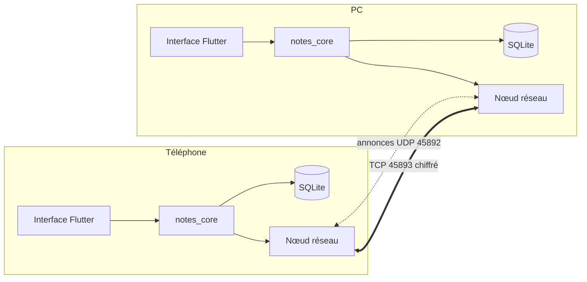

# Architecture technique

## 1. Choix

| Sujet | Choix | Raison |
|---|---|---|
| Applications | **Flutter**, une seule base de code Dart | application native Android + Windows (pas de page web), règles métier partagées |
| Base locale | **SQLite** + recherche plein texte FTS5 | tout fonctionne sans réseau, recherche instantanée |
| Synchronisation | **directe entre appareils** sur le réseau local | aucun compte, aucun serveur, aucune donnée sur Internet, gratuit |
| Association | code à 6 chiffres + échange de clés authentifié (SPEKE) | simple à saisir, résistant aux écoutes et aux essais hors ligne |
| Chiffrement | ChaCha20-Poly1305, clés éphémères par session | confidentialité et intégrité de chaque message |

La version 1 synchronisait par un serveur en ligne (Supabase). Elle a été
remplacée, à la demande, par cette synchronisation locale sans compte.

**Limite assumée** : deux appareils ne se synchronisent que lorsqu'ils sont
sur le même réseau avec l'application ouverte. Entre-temps, chacun fonctionne
normalement et les modifications attendent.

## 2. Vue d'ensemble



```
packages/notes_core/            logique partagée, pur Dart (aussi exécutée par les tests)
  lib/src/models.dart           Note, Block, Folder, Tag, Attachment
  lib/src/local_store.dart      base SQLite : éléments, révisions, journal, appareils, historique
  lib/src/merge.dart            fusion à trois voies (champs, blocs, étiquettes)
  lib/src/repository.dart       opérations métier (notes, dossiers, étiquettes, corbeille, conflits)
  lib/src/lan/speke.dart        échange de clés authentifié par le code ou la clé d'association
  lib/src/lan/channel.dart      trames, canal chiffré, requêtes/réponses
  lib/src/lan/discovery.dart    annonces UDP sur le réseau local
  lib/src/lan/sync_driver.dart  algorithme de synchronisation entre deux appareils
  lib/src/lan/lan_node.dart     écoute, connexions, association, reconnexion automatique
app/                            application Flutter (thème, éditeur, écrans)
installer/                      installateur Windows (Inno Setup) avec désinstalleur
```

## 3. Découverte et connexion

* Chaque appareil écoute en TCP sur le port **45893** et diffuse toutes les
  5 secondes une annonce UDP (port **45892**) contenant son identifiant, son
  nom et son port. Un appareil qui reçoit une annonce répond directement à
  l'émetteur : cela fonctionne même quand les diffusions entrantes sont
  filtrées (fréquent sur Android).
* Les adresses des appareils associés sont mémorisées : au démarrage,
  l'application les rappelle directement.
* En dernier recours, l'application cherche l'autre appareil sur le
  sous-réseau (connexion de test sur le port 45893).
* Une fois connectés, les deux appareils gardent la connexion ouverte : une
  modification part en moins d'une seconde. Une connexion silencieuse est
  vérifiée puis rétablie automatiquement.

L'annonce ne contient aucun secret et ne donne aucun accès.

## 4. Association et sécurité

1. L'appareil A affiche un code aléatoire à 6 chiffres, valable 5 minutes.
2. L'appareil B le saisit. Les deux réalisent un **échange de clés SPEKE**
   (groupe MODP 2048 bits de la RFC 3526, générateur dérivé du code) : seuls
   deux appareils connaissant le même code obtiennent la même clé, et chacun
   prouve à l'autre qu'il la possède avant tout échange de données.
3. Un tiers qui écoute le réseau ne peut ni en déduire le code ni tester des
   codes hors ligne. En se faisant passer pour un appareil, il ne peut tester
   **qu'un code par tentative** ; le code est **annulé à la 3e tentative**.
4. Les deux appareils en tirent une **clé d'association de 256 bits**, rangée
   dans le coffre du système (Android Keystore, protection des données
   Windows). Les connexions suivantes refont le même échange avec cette clé,
   avec de nouvelles clés de session à chaque fois.
5. Tous les messages passent ensuite par **ChaCha20-Poly1305** (une clé par
   sens, compteur de messages) : un message modifié, rejoué ou forgé est
   refusé et la connexion est coupée.

Un appareil non associé, ou retiré de la liste, ne peut ni lire ni écrire.

## 5. Synchronisation

### Écriture locale d'abord

Chaque action est **immédiatement** écrite dans SQLite (`synchronous = FULL`).
Chaque élément (note, dossier, étiquette, pièce jointe) porte :

* une **révision** propre à l'appareil, augmentée à chaque changement ;
* une position dans le **journal des changements** de l'appareil.

Pour chaque appareil associé, la base retient le dernier contenu commun
(ancêtre pour la fusion) et la révision de l'élément chez l'autre. Ce qui
reste à transmettre se déduit de ces informations : pas de file séparée qui
pourrait se désynchroniser, et rien n'est perdu après un redémarrage ou une
coupure.

### Échange entre deux appareils

Entre deux appareils, celui dont l'identifiant est le plus petit **pilote**
l'échange, l'autre répond. Un tour d'échange :

1. le pilote demande ce qui a changé chez l'autre depuis sa dernière position
   dans le journal (par pages de 200, position mémorisée après chaque page :
   une coupure reprend là où elle s'était arrêtée) ;
2. il intègre chaque élément reçu : adopté si rien n'a changé localement,
   fusionné sinon ;
3. il envoie ses propres modifications. Chaque écriture chez l'autre est
   **conditionnelle** : acceptée seulement si l'élément n'a pas changé
   là-bas depuis le dernier échange ; sinon l'autre renvoie sa version et le
   pilote fusionne. Rien n'est jamais écrasé sans comparaison ;
4. les pièces jointes manquantes sont transférées dans les deux sens (par
   morceaux de 256 Ko, empreinte SHA-256 vérifiée à l'arrivée).

Un tour est relancé 0,4 s après une modification (locale ou signalée par
l'autre appareil) et vérifié toutes les 5 s.

### Conflits

La décision ne repose **jamais sur l'heure de modification** : seules les
différences par rapport à l'ancêtre commun comptent (fusion à trois voies).

| Situation | Résultat |
|---|---|
| Champs différents modifiés de chaque côté | fusion automatique |
| Blocs différents d'une même note | fusion automatique, bloc par bloc, ordre conservé |
| Étiquettes ajoutées / retirées des deux côtés | ajouts et retraits combinés |
| Même bloc ou même titre modifié différemment | **choix proposé à l'utilisateur** |
| Bloc modifié d'un côté, supprimé de l'autre | **choix proposé** |
| Note modifiée d'un côté, supprimée définitivement de l'autre | **choix proposé** |
| Note modifiée d'un côté, mise à la corbeille de l'autre | texte conservé, note dans la corbeille |
| Favori, dossier, archivage modifiés des deux côtés | le choix de l'appareil pilote est retenu (aucun contenu perdu) |

En cas de conflit, la version locale reste intacte, l'autre est mise de côté
et la note n'est plus transmise tant que l'utilisateur n'a pas choisi :
*garder la mienne*, *garder l'autre* ou *garder les deux*. Le choix est
proposé sur l'appareil qui pilote l'échange.

### Historique

Avant chaque modification du titre ou du contenu, l'ancienne version est
conservée : au plus un instantané toutes les 2 minutes pendant la frappe, et
toujours avant une modification venue d'un autre appareil ou une résolution
de conflit (50 versions par note). L'éditeur permet de les consulter et d'en
restaurer une.

### Suppressions

Les suppressions sont des « pierres tombales » (`trashed_at`, `deleted`,
`purged`) qui se propagent comme des modifications. Une suppression
définitive vide le contenu et l'historique de la note.

## 6. Format des données

Le contenu d'une note est une liste de blocs JSON identifiés :

```json
{ "blocks": [
  { "id": "b1", "type": "h1",    "text": "Révisions" },
  { "id": "b2", "type": "todo",  "text": "Exercices **Grafcet**", "checked": true },
  { "id": "b3", "type": "image", "attachment_id": "…" },
  { "id": "b4", "type": "table", "rows": [["Repère", "Désignation"], ["KM1", "Contacteur"]] }
]}
```

Types : `p`, `h1`, `h2`, `quote`, `bullet`, `numbered`, `todo`, `code`,
`divider`, `image`, `file`, `table`. Mise en forme en ligne : `**gras**`,
`*italique*`, `++souligné++`, `~~barré~~`, `` `code` ``, `[texte](lien)`.
Les champs inconnus sont conservés (compatibilité entre versions).
