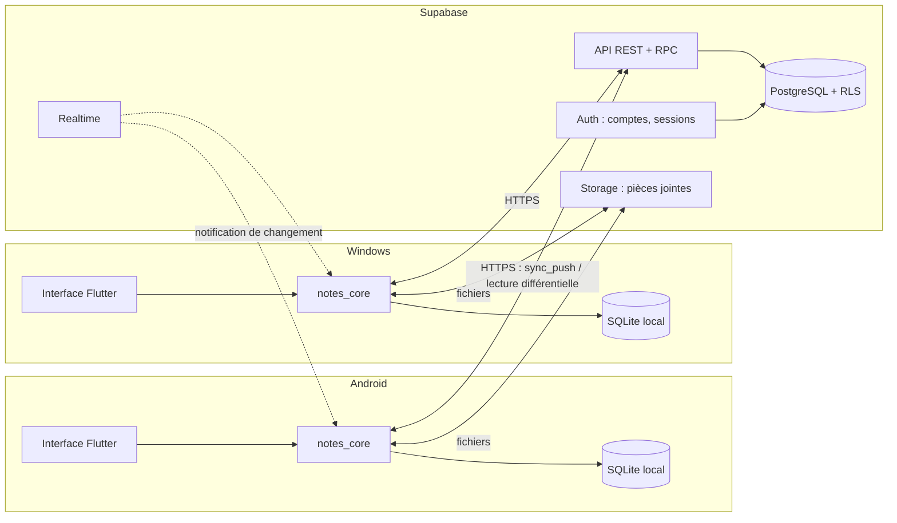

# Architecture technique

## 1. Choix des technologies

### Backend

| Critère | **Supabase** (retenu) | Firebase | Backend personnalisé |
|---|---|---|---|
| Coût pour un usage personnel | Gratuit (500 Mo de base, 1 Go de fichiers) | Gratuit (Spark), Storage désormais lié à un compte de facturation | Hébergement à trouver et à maintenir |
| Base de données | PostgreSQL relationnel, transactions, fonctions SQL | NoSQL (Firestore), règles limitées pour une logique de version | Au choix |
| Contrôle de version / conflits côté serveur | Fonction SQL transactionnelle (`sync_push`) | Transactions Firestore, logique répartie dans les règles | À écrire entièrement |
| Isolation des comptes | Row Level Security vérifiée par PostgreSQL | Règles de sécurité Firestore | À écrire |
| Comptes, fichiers, temps réel | Inclus | Inclus | À écrire |
| Client pour Windows | Bibliothèque Dart officielle, pure Dart | Pas de SDK officiel Windows pour Flutter (Firestore) | — |
| Réversibilité | Open source, auto-hébergeable, export SQL standard | Propriétaire | Totale |

**Supabase** est retenu : un seul service couvre les huit composants demandés
(base distante, authentification, stockage objet, temps réel), la logique de
synchronisation tient dans une fonction PostgreSQL testable, et le client Dart
fonctionne à l'identique sur Android et Windows.

*Limite de l'offre gratuite* : un projet inactif 7 jours est mis en pause ; la
tâche GitHub `keepalive.yml` l'évite. Pas de sauvegarde automatique incluse :
voir [SAUVEGARDE.md](SAUVEGARDE.md).

### Applications

| Critère | **Flutter** (retenu) | Kotlin + C#/WinUI | Electron / Tauri |
|---|---|---|---|
| Une seule base de code Android + Windows | Oui | Non (deux applications) | Android impossible ou limité |
| Application Windows native | Oui (moteur de rendu natif, exécutable Win32, pas de page web) | Oui | Non (page web dans une fenêtre) |
| Règles métier partagées | Oui (même code Dart) | Dupliquées | — |

Une seule base de code Dart : la même logique de synchronisation, de fusion et
de stockage tourne sur les deux plateformes et dans les tests automatisés.

### Base locale

SQLite (via `sqlite3`, avec la recherche plein texte FTS5) sur chaque appareil.

## 2. Vue d'ensemble



## 3. Organisation du code

```
packages/notes_core/          logique métier partagée (pur Dart, sans Flutter)
  lib/src/models.dart         Note, Block, Folder, Tag, Attachment
  lib/src/local_store.dart    base SQLite locale, file d'attente persistante, recherche FTS5
  lib/src/merge.dart          fusion à trois voies (champs, blocs, étiquettes)
  lib/src/sync_engine.dart    moteur de synchronisation
  lib/src/repository.dart     opérations métier (créer, corbeille, dossiers, conflits…)
  lib/src/remote.dart         contrat d'accès au serveur
  lib/src/supabase_remote.dart  implémentation Supabase + comptes
  lib/src/fake_remote.dart    serveur simulé pour les tests
  lib/src/inline.dart         mise en forme en ligne (**gras**, ++souligné++…)
  lib/src/export.dart         export TXT / Markdown / HTML
app/                          application Flutter (Android + Windows)
  lib/theme.dart              identité graphique (palette, points, logo)
  lib/state/app_controller.dart  état de l'application, session, navigation
  lib/editor/                 éditeur par blocs
  lib/screens/                connexion, écran principal, paramètres
  lib/widgets/                navigation, liste, dialogues
  lib/services/               export PDF, stockage sécurisé, mises à jour
supabase/migrations/          schéma, sécurité, fonctions SQL
supabase/tests/               tests SQL (sécurité, conflits, idempotence)
installer/                    installateur Windows (Inno Setup)
tools/                        génération des projets natifs
.github/workflows/            tests, compilation, publication, maintien, sauvegarde
```

## 4. Synchronisation

### Écriture locale d'abord

Chaque action de l'utilisateur est **immédiatement** écrite dans SQLite
(`PRAGMA synchronous = FULL`), puis ajoutée à la **file d'attente persistante**
(`outbox`). Rien n'attend le réseau : l'application est entièrement utilisable
hors ligne et une coupure ne fait rien perdre.

Chaque élément local conserve :

* `data` — l'état affiché ;
* `base` — la dernière version confirmée par le serveur (ancêtre commun) ;
* `conflict` — une version serveur concurrente non résolue ;
* `dirty`, `local_rev` — modifications locales en attente.

### Envoi

Pour chaque opération de la file, le moteur appelle `sync_push(entité, ligne,
version_de_base, op_id)` :

* **version de base = version serveur** → le serveur applique, incrémente la
  version et répond `ok` ;
* **version différente** → le serveur n'écrit rien et répond `conflict` avec sa
  version : le client fusionne (voir plus bas) ;
* **op_id déjà vu** (réponse perdue puis renvoi) → `duplicate` : rien n'est
  appliqué deux fois.

Un identifiant d'opération est régénéré à chaque modification locale ; un même
identifiant correspond donc toujours au même contenu.

Les pièces jointes sont envoyées dans le stockage **avant** leur fiche, dans un
dossier `<id utilisateur>/<id pièce jointe>/<nom>`.

### Réception différentielle

Chaque écriture reçoit un numéro de séquence serveur croissant (`server_seq`).
Un appareil ne demande que les lignes dont `server_seq` dépasse son curseur, par
pages de 500, et **enregistre le curseur après chaque page** : une coupure en
cours de réception reprend là où elle s'était arrêtée. Les écritures d'un même
compte sont sérialisées (verrou consultatif PostgreSQL) pour que l'ordre des
séquences corresponde à l'ordre de validation : aucune ligne ne peut être
sautée.

Les suppressions sont des **pierres tombales** (`trashed_at`, `deleted`,
`purged`) : elles se propagent comme des modifications.

### Déclenchement automatique

* 0,8 s après une modification locale ;
* instantanément sur notification **temps réel** du serveur (un autre appareil
  a écrit) ;
* toutes les 60 s ;
* après un échec réseau, avec un délai croissant (5 s, 10 s, 20 s… 5 min).

### Résolution des conflits

La décision ne repose **jamais sur l'heure de modification** : seules les
différences par rapport à l'ancêtre commun comptent (fusion à trois voies).

| Situation | Résultat |
|---|---|
| Champs différents modifiés de chaque côté (ex. titre ici, contenu là-bas) | Fusion automatique |
| Blocs différents d'une même note modifiés | Fusion automatique, bloc par bloc (ordre conservé) |
| Étiquettes ajoutées/retirées des deux côtés | Union des ajouts, application des retraits |
| Même bloc ou même titre modifié différemment | **Conflit présenté à l'utilisateur** |
| Bloc modifié d'un côté, supprimé de l'autre | **Conflit présenté à l'utilisateur** |
| Note modifiée d'un côté, supprimée définitivement de l'autre | **Conflit présenté à l'utilisateur** |
| Note modifiée d'un côté, mise à la corbeille de l'autre | Modifications conservées, note dans la corbeille (récupérable) |
| Favori / dossier / archivage modifiés des deux côtés | Le choix de l'appareil qui synchronise en dernier est retenu (sans perte de contenu) |

En cas de conflit, la version locale reste intacte, la version serveur est mise
de côté et rien n'est envoyé tant que l'utilisateur n'a pas choisi : **garder
la mienne**, **garder l'autre** ou **garder les deux** (la version locale devient
une nouvelle note). La version écartée reste consultable dans l'historique.

### Historique

Un déclencheur PostgreSQL archive l'ancienne version d'une note à chaque
modification de son titre ou de son contenu (50 dernières versions par note).
L'éditeur permet de les consulter et d'en restaurer une.

## 5. Sécurité

* Communications **HTTPS** uniquement.
* **Row Level Security** : chaque table n'est lisible que pour `user_id = auth.uid()`.
* **Aucune écriture directe** : les clients n'ont que le droit de lecture ; toute
  écriture passe par `sync_push`, qui impose l'identifiant du propriétaire et
  refuse de modifier la ligne d'un autre compte.
* Stockage des fichiers privé, limité au dossier de l'utilisateur.
* Les applications ne contiennent que la clé **publique** (anon). Aucune clé
  d'administration n'est livrée.
* Jetons de session chiffrés sur l'appareil : clé de 256 bits dans le coffre du
  système (Android Keystore, protection des données Windows) via
  `flutter_secure_storage`, session chiffrée et authentifiée dans un fichier.
* Suppression du compte : fichiers puis toutes les données (cascade SQL).
* « Déconnecter tous les appareils » révoque toutes les sessions du compte.

**Chiffrement de bout en bout : non proposé.** Les notes sont protégées en
transit (HTTPS) et par l'isolation des comptes, mais le serveur peut techniquement
les lire. Un vrai chiffrement de bout en bout imposerait une gestion de clés et
une récupération en cas d'oubli du mot de passe qui n'existent pas ici ; il
n'est donc pas annoncé.

## 6. Format des données

Voir [API.md](API.md).
